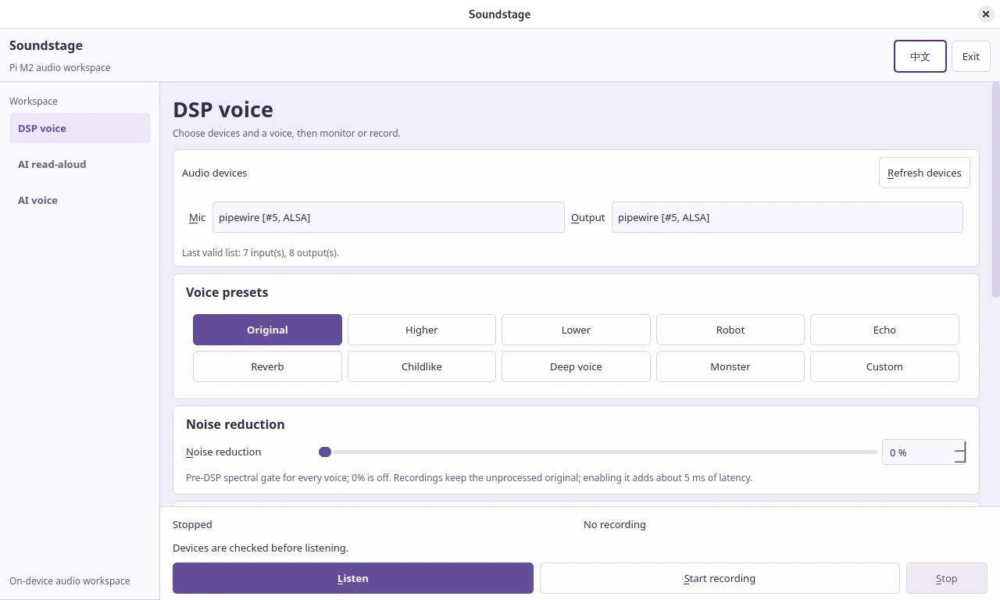

[简体中文](README_zh.md) | English

# Voice Changer for Quectel Pi M2

A real-time voice changer for the [Quectel Pi M2](https://developer.quectel.com/doc/sbc/en/index.html) Linux desktop, written in Python with PySide6. Microphone capture runs through a local DSP chain (Rubber Band pitch and formant shifting, optional spectral-gate noise reduction and fun effects) and is played back to your headphones or into a PipeWire virtual microphone that other applications can select as an input. Optional AI modes add read-aloud text-to-speech and model-based voice conversion.



*The Soundstage window: audio-device selection, voice presets, noise reduction and the monitoring bar.*

> **Scope:** This is a board demo, not a hardened audio product. The DSP presets are effects, not AI voice conversion, and every AI mode is opt-in: it needs models and runtime libraries that are not shipped in this repository, and its quality and latency are not fully accepted. Output volume and device routing are yours to configure.

## Features

- Lavender **Soundstage** workspace: a shared sidebar, grouped DSP and AI pages, fixed action bars and an in-place Chinese/English switch. Compact windows keep mode navigation and **Stop** accessible.
- Real-time monitoring with a capture-to-output DSP chain: pitch (±12 semitones) and formant (0.8×–1.25×) shifting through streaming Rubber Band, plus ring modulation, echo and short reverb.
- Optional noise reduction before the pitch/formant chain: a streaming spectral gate from 0 to 100 % (off by default) with an always-visible strength control. It adds about 5 ms of fixed lookahead and also applies to the Original preset.
- Nine voice presets, from adult male/female ranges to robot, echo, reverb and cartoon voices (table below).
- Input and output gain from −24 dB to +12 dB, with the output peak limit applied last.
- Dual-track recording: the original (pre-gain) track and the processed track, A/B playback, and saving to a recording folder of your choice.
- Live level meters: rolling peak envelopes and dBFS readings for the microphone and the processed signal, with low/mid/high band RMS and a pitch estimate.
- PipeWire virtual microphone output (default name `vcmic`), so any application can select **Voice Changer Virtual Mic** as an input. A clear message appears when `pw-loopback`/`pw-dump` are unavailable.
- Optional AI modes: **AI read aloud** (Kokoro Chinese text-to-speech presets), **AI voice** (LLVC streaming ONNX conversion, an experimental HEVC RKNN/NPU path, and offline male-voice previews with the experimental Beatrice engine). AI conversion is opt-in; without a model and runtime the start action stays disabled with setup guidance, and there is no passthrough or DSP fallback.
- Safe defaults: the window opens with monitoring off and no capture, and audio starts only after you confirm the device and the level.

**Supported presets**

> The output peak limit is a software clamp, not a guarantee that the level is safe for your hearing.

| Preset | Pitch | Formant | Effect |
|--------|-------|---------|--------|
| Original | 0 st | 1.00 | Bypass; keeps gain and the final limiter |
| Male → Female | +7 st | 1.18 | Adult female range; listening acceptance pending |
| Female → Male | −6 st | 0.86 | Adult male range; listening acceptance pending |
| Robot | 0 st | 1.00 | 80 Hz sine ring modulation, 80 % mix |
| Echo | 0 st | 1.00 | 200 ms delay, 25 % feedback, 25 % mix |
| Short reverb | 0 st | 1.00 | Four comb filters (31/37/41/47 ms), 20 % mix |
| Loli | +6 st | 1.25 | Candidate preset; listening acceptance pending |
| Uncle | −4 st | 0.90 | Candidate preset; listening acceptance pending |
| Monster | −8 st | 0.80 | −8 st with 15 % echo |

The formant value is the net vocal-tract shift relative to the original voice: 1.00 keeps it even while the pitch moves. Noise reduction is independent of the preset and is not stored with it.

## Hardware Requirements

- Quectel Pi M2 (RK3576) running Debian 13
- An input device (USB microphone, headset, or the board's analog input)
- An output device (headphones or speakers)
- A display, for the desktop window
- PipeWire, only if you want the virtual microphone output

## Software Environment Setup

- Operating System: Debian 13 (the default OS for Quectel Pi M2)
- Python: 3.10 or newer; on the board, use the system Python 3.13 with PySide6 (see the note in [Security and limitations](#security-and-limitations))
- Runtime: PySide6 (Qt Widgets), NumPy, sounddevice/PortAudio, Rubber Band 3.3 (`librubberband.so.2`)
- Virtual microphone: PipeWire with `pw-loopback` and `pw-dump`

The scripted deployment reuses the Qt, NumPy, Rubber Band and PortAudio packages that the board image already provides; it does not install system packages. Check what the board currently has:

```bash
python3 -V
python3 -c "import PySide6, numpy; print(PySide6.__version__, numpy.__version__)"
ldconfig -p | grep librubberband
```

### Implementation Steps

1. Clone the project using git.

```bash
sudo apt update
sudo apt install -y git
git clone https://github.com/Quectel-Pi/demo-voice-changer.git
```

After execution, a `demo-voice-changer` folder should be created in the current directory.

2. Run the following commands in sequence on the board's terminal. If the terminal shows `Deployment complete`, deployment is successful.

```bash
cd demo-voice-changer
chmod +x install.sh
./install.sh
```

The script checks the interpreter, creates `.venv` with `--system-site-packages` so the system Qt and NumPy are reused, registers `src/` on the environment, and finally prints `voice-changer 1.0.0-demo.1`. It does not start audio, change PipeWire, volume or routing, install system packages, or run as root.

Add `--with-audio` to install the pinned `sounddevice`/CFFI wheels into the environment (needs network access), or `--deploy-to ~/voice-changer-demo` to set up a standalone copy. Use `./install.sh --help` for the remaining options and `--dry-run` to see the commands without changing anything.

3. Verify the version. If the output is `voice-changer 1.0.0-demo.1`, the installation is successful.

```bash
.venv/bin/python -B -m voice_changer --version
```

## Project Structure

```
demo-voice-changer/
├── docs/
│   ├── images/                  # README screenshots
│   ├── DEMO_GUIDE.md            # Shortest start-up and demo walkthrough (English)
│   ├── DEMO_GUIDE_zh.md         # 中文版：最短启动与演示指南
│   ├── RKNN_HEVC.md             # Experimental HEVC to RKNN/NPU conversion guide (English)
│   ├── RKNN_HEVC_zh.md          # 中文版：HEVC 转 RKNN/NPU 实验指南
│   ├── RKNN_LLVC.md             # LLVC ONNX streaming benchmarks (English)
│   └── RKNN_LLVC_zh.md          # 中文版：LLVC ONNX 流式基准
├── src/voice_changer/
│   ├── ai/                      # Optional AI: LLVC, TTS, RKNN adapters, model catalog
│   ├── app/                     # Entry point, controller, device selection, preferences
│   ├── audio/                   # Engine, backends, discovery, recording, virtual mic, analysis
│   ├── dsp/                     # Effect parameters, Rubber Band wrapper, streaming effects
│   └── ui/                      # Soundstage window, AI pages, canvases, theme, i18n
├── scripts/                     # Deploy, package, desktop entry, conversion and benchmark tools
├── tests/
│   ├── unit/                    # Standard-library, DSP and AI adapter tests
│   ├── integration/             # Qt offscreen tests with device/controller stand-ins
│   └── board/                   # Reserved for board-only checks
├── configs/                     # Shareable default parameters
├── assets/                      # Static assets
├── packaging/                   # Packaging resources
├── install.sh                   # Environment deployment script
├── README.md                    # English documentation
├── README_zh.md                 # Chinese documentation
└── requirements-*.txt           # Pinned runtime, test and AI dependency sets
```

## Run the program

Start the desktop entry, then confirm the devices in the window. Nothing is captured or played until you press **Start monitoring**.

```bash
cd demo-voice-changer
.venv/bin/python -B -m voice_changer
```

1. Wait for the automatic device discovery and confirm or select the input and output device.
2. Choose a preset, or switch to **Custom** to edit pitch, formant, robot, echo, reverb and gain. The noise-reduction panel sets the strength (0–100 %) for the current session.
3. Press **Start monitoring** in the footer. Audio starts only after the device and configuration are validated.
4. Press **Stop** to release the stream and the DSP thread. Closing the window performs the same asynchronous cleanup.

Recording and monitoring are separate: you can record without an output device, and monitoring does not capture the microphone. Recordings are written to a temporary group under the XDG user data directory and are kept only when you save them.

To feed the processed voice to other applications, select **Voice Changer Virtual Mic** (`vcmic`) as the output device. It requires a running PipeWire session with `pw-loopback` and `pw-dump`. For the shortest end-to-end walkthrough, including the desktop-entry generator, see [docs/DEMO_GUIDE.md](docs/DEMO_GUIDE.md).

## AI modes (optional)

The header switches between **DSP voice** (Ctrl+1), **AI read aloud** (Ctrl+2) and **AI voice** (Ctrl+3). Stop all audio before switching modes; nothing is stopped automatically. Models and runtimes are not downloaded or bundled with this repository — load only trusted model files.

- **AI read aloud:** Kokoro Chinese presets 女声 (`zf_xiaobei`), 晓晓 (`zf_xiaoxiao`) and 男声 (`zm_yunjian`). Point `VOICE_CHANGER_KOKORO_MODEL` at an extracted `kokoro-int8-multi-lang-v1_0` directory and `VOICE_CHANGER_KOKORO_PYTHON` at a Python with sherpa-onnx installed. Generation runs in an isolated, memory-limited worker process; a short sentence took about 20–25 s on Pi M2.
- **AI voice (LLVC):** streaming LLVC ONNX conversion for live voice changing. Set `VOICE_CHANGER_LLVC_MODEL` to a compatible model, or choose it on the AI voice page; the app validates the tensor interface and state shapes before starting. The page lists a single female voice, **晓晓** (LLVC, the lowest-latency path); HEVC experimental models can still be added with **Add local model…**, but they are identified only and Start stays disabled.
- **Experimental HEVC RKNN/NPU path:** the HEVC models can be converted host-side to RKNN packages for the RK3576 NPU (`scripts/convert_hevc_rknn.py`, pipeline and accuracy gates in [docs/RKNN_HEVC.md](docs/RKNN_HEVC.md)). The NPU session runs in a separate helper process selected by `VOICE_CHANGER_RKNN_PYTHON`. It measured about 0.56–0.60 realtime factor with roughly 0.4–0.6 s added latency, so it is not a low-latency path, and quality and long-run stability still need board acceptance; RKNN packages must be built with rknn-toolkit2>=2.5.0 (the 2.3.2 compiler miscompiles this network, see docs/RKNN_HEVC.md).
- **Experimental Beatrice engine:** a toggle for the Beatrice v2 engine, configured with `VOICE_CHANGER_BEATRICE_MODEL_DIR` and `VOICE_CHANGER_BEATRICE_API_DIR`. The model is under a non-commercial licence, it was close to realtime on the board (RTF ≈ 0.94), and it can underrun when the block budget is exceeded — LLVC is recommended for live use. Setting `VOICE_CHANGER_BEATRICE_SUBPROCESS=1` runs the conversion in a separate helper process (`scripts/beatrice_worker.py`); this is an unaccepted realtime experiment: on the board a 1024-frame block (21.3 ms) averaged about 19.6 ms with p95 near 27 ms, a 30 s queue simulation had no underruns, and a real window ran for more than 2 minutes without errors. Jitter can still interrupt it; quality and long-run stability remain unaccepted, and this is not a realtime guarantee.
- **Offline JVS previews (Beatrice v2, experimental):** after enabling **Enable Beatrice v2 (experimental)** on the AI voice page, click a voice button to pick a JVS voice — three female candidates (JVS 10, 14 and 93, high `average_pitch` values) and the low male candidate (JVS 6) — or use **Custom index…** for any index 1–100. The engine keeps the source pitch, so each female candidate also defaults to a +12 semitone pitch lift and a post-model Rubber Band formant stage (net envelope ×1.18); the native formant parameter is capped at 2 semitones and measured too weak to leave the male timbre. Measured on the board, a 124 Hz male source becomes about 232–259 Hz and the spectral centroid rises into the female range; the stage costs about 3.5 ms per 1024-frame block and runs in the GUI process while the helper process runs the model. **Try offline…** records about 5 s, converts the whole clip once offline, plays it once and saves a WAV under `$XDG_DATA_HOME/voice-changer/previews/`; this is offline conversion, not live conversion. The labels are audition tags derived from public `average_pitch` metadata, not voiceprint or gender verification; the JVS corpus and Beatrice v2 model are under a non-commercial licence and are not distributed with this repository.
- **RVC:** ONNX and RKNN adapters exist as isolated development components; there is no accepted live RVC audio path yet, so **Start** stays disabled for these models.

The weights used by the experimental HEVC models are not distributed with this repository. `scripts/fetch_hevc_models.py` downloads them with SHA-256 checks for local experiments; they are GPL-3.0 and are kept out of release artifacts. See [docs/RKNN_LLVC.md](docs/RKNN_LLVC.md) for the LLVC streaming benchmarks.

## Testing without hardware

The unit and Qt integration suites use stand-in devices and synthetic signals, so they run on a desktop without audio hardware.

```bash
PYTHONDONTWRITEBYTECODE=1 PYTHONPATH=src .venv/bin/python -B -m unittest discover -s tests/unit -p 'test_*.py'
QT_QPA_PLATFORM=offscreen PYTHONDONTWRITEBYTECODE=1 PYTHONPATH=src .venv/bin/python -B -m unittest discover -s tests/integration -p 'test_*.py'
```

Cases that need a real Rubber Band 3.3 library (and real audio timing) are skipped when the library is unavailable; they are not a substitute for board listening tests.

## Related Projects

More board demos are available in the [Quectel-Pi](https://github.com/Quectel-Pi) organization:

- [demo-gesture-remote-control](https://github.com/Quectel-Pi/demo-gesture-remote-control): touchless video control based on hand gesture recognition.
- [demo-personal-cloudhost](https://github.com/Quectel-Pi/demo-personal-cloudhost): a personal cloud host for the local network.
- [demo-fall-detect](https://github.com/Quectel-Pi/demo-fall-detect): fall detection with an abnormal-sound alarm.

## Documentation

- [docs/DEMO_GUIDE.md](docs/DEMO_GUIDE.md): shortest start-up and demo steps.
- [docs/RKNN_HEVC.md](docs/RKNN_HEVC.md): HEVC to RKNN/NPU conversion, accuracy gates and board results.
- [docs/RKNN_LLVC.md](docs/RKNN_LLVC.md): LLVC streaming ONNX benchmarks.

Chinese editions: [DEMO_GUIDE_zh.md](docs/DEMO_GUIDE_zh.md), [RKNN_HEVC_zh.md](docs/RKNN_HEVC_zh.md), [RKNN_LLVC_zh.md](docs/RKNN_LLVC_zh.md).

## Security and limitations

- The software applies a configurable output peak limit, but this is not a guarantee that the volume is safe for your hearing. Check the level on your own equipment.
- End-to-end physical latency has not been measured. Only DSP and scheduling configuration plus software-reported fields are recorded; do not read them as a physical latency figure.
- Noise reduction is a demo-level spectral gate, not noise suppression with AGC or echo cancellation. Sustained tonal sounds may be partly treated as noise, and the processed track gains about 5 ms (256 frames at 48 kHz) of documented lookahead.
- Pitch detection covers 50–800 Hz and may miss or misread mixed voices. The meter is an overview, not a quality verdict, and it is not a spectrum analyser.
- The **Robot** preset is DSP ring modulation, not an AI vocoder or a person-specific timbre.
- AI modes require separately installed models and runtimes; real audio quality, device playback and conversion remain subject to listening acceptance. Loading a model may execute code, so only load trusted files.
- On RK3576/Debian 13, run the desktop with the system Python 3.13 PySide6 runtime. A Python 3.10 process driving Qt callbacks reproduced a `Fatal Python error: none_dealloc` on the board; do not mix the board's system Qt with a Python 3.10 AI environment.
- The virtual microphone needs PipeWire; without it the UI reports the failure and normal monitoring is unaffected.
- Presets marked as candidates have not been confirmed by listening tests on real speech.
- This project is a board demo, not a hardened distribution. Clean-system installation and the complete audio dependency closure are not verified.

## Reporting Issues
If you encounter any issues during use, please submit technical inquiries on the [Quectel Official Forum](https://forumschinese.quectel.com/c/quectel-pi/58). Our technical support team will respond promptly.
Issues and Pull Requests are welcome to help improve this project.
