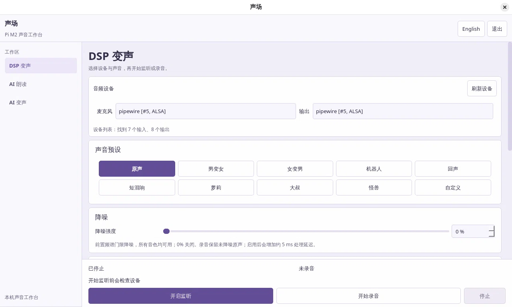

[English](README.md) | 简体中文

# 变声器：Quectel Pi M2 桌面版

面向 [Quectel Pi M2](https://developer.quectel.com/doc/sbc/en/index.html) 板卡 Linux 桌面的实时变声器，使用 Python 与 PySide6 编写。麦克风采集的声音经本地 DSP 链路（Rubber Band 音高与共振峰变换、可选频谱门限降噪及趣味音效）处理后，输出到耳机，或输出到 PipeWire 虚拟麦克风，供其他应用选择为输入。可选 AI 模式提供文本朗读与基于模型的变声。



*声场窗口：音频设备选择、声音预设、降噪与监听栏。*

> **范围：** 本项目是板卡 Demo，不是加固的音频产品。DSP 预设只是音效，不是 AI 变声；所有 AI 模式均为可选项：需要本仓库未附带的模型与运行时库，其质量与延迟也尚未完全验收。输出音量与设备路由需你自行配置。

## 功能特性

- 雾紫**声场**工作台：统一侧栏、DSP 与 AI 分组页面、固定操作区和原位中英文切换。窄窗口下仍保留模式导航与**停止**操作。
- 实时监听与采集到输出的 DSP 链路：通过流式 Rubber Band 做音高（±12 半音）与共振峰（0.8×–1.25×）变换，另含环形调制、回声与短混响。
- 可选降噪，作用于音高/共振峰链路之前：0–100% 的流式频谱门限（默认关闭），强度控件常驻显示。它增加约 5 ms 固定前瞻延迟，并对“原声”预设同样生效。
- 九种声音预设：从成年男声/女声范围到机器人、回声、混响与卡通音色（见下表）。
- 输入与输出增益 −24 dB 至 +12 dB，输出峰值上限最后生效。
- 双轨录音：原声（增益前）轨与效果轨、A/B 试听，并可保存到你选择的录音目录。
- 实时电平表：麦克风与处理后信号各自的滚动峰值包络与 dBFS 读数，附低/中/高频段 RMS 与音高估计。
- PipeWire 虚拟麦克风输出（默认名称 `vcmic`），任何应用都可把 **Voice Changer Virtual Mic** 选为输入。`pw-loopback`/`pw-dump` 不可用时会给出明确提示。
- 可选 AI 模式：**AI 朗读**（Kokoro 中文语音合成预设）、**AI 变声**（LLVC 流式 ONNX 转换、实验性 HEVC RKNN/NPU 链路，以及实验性 Beatrice 引擎的男声离线试听）。AI 变声为可选项；缺少模型与运行时的时候启动按钮保持禁用并给出配置提示，不使用原声直通或 DSP 兜底。
- 安全默认：窗口打开时监听关闭、不采集，只有在你确认设备与电平后才启动音频。

**支持的预设**

> 输出峰值上限是软件限幅，不保证该电平对你的听觉安全。

| 预设 | 音高 | 共振峰 | 效果 |
|--------|-------|---------|--------|
| 原声 | 0 半音 | 1.00 | 旁路；保留增益与最终限幅 |
| 男变女 | +7 半音 | 1.18 | 成年女声范围；听感验收待完成 |
| 女变男 | −6 半音 | 0.86 | 成年男声范围；听感验收待完成 |
| 机器人 | 0 半音 | 1.00 | 80 Hz 正弦环形调制，混合 80% |
| 回声 | 0 半音 | 1.00 | 200 ms 延迟，反馈 25%，混合 25% |
| 短混响 | 0 半音 | 1.00 | 四路梳状滤波器（31/37/41/47 ms），混合 20% |
| 萝莉 | +6 半音 | 1.25 | 候选预设；听感验收待完成 |
| 大叔 | −4 半音 | 0.90 | 候选预设；听感验收待完成 |
| 怪兽 | −8 半音 | 0.80 | −8 半音并加 15% 回声 |

共振峰数值表示相对原声的声腔整体偏移：1.00 表示即使音高变化也保持原声特征。降噪与预设相互独立，不随预设保存。

## 硬件要求

- Quectel Pi M2（RK3576），运行 Debian 13
- 输入设备（USB 麦克风、耳麦或板载模拟输入）
- 输出设备（耳机或扬声器）
- 显示设备，用于桌面窗口
- PipeWire，仅在使用虚拟麦克风输出时需要

## 软件环境准备

- 操作系统：Debian 13（Quectel Pi M2 的默认系统）
- Python：3.10 及以上；在板端请使用系统 Python 3.13 与 PySide6（见[安全与限制](#安全与限制)中的说明）
- 运行时：PySide6（Qt Widgets）、NumPy、sounddevice/PortAudio、Rubber Band 3.3（`librubberband.so.2`）
- 虚拟麦克风：PipeWire，含 `pw-loopback` 与 `pw-dump`

脚本化部署复用板卡镜像已提供的 Qt、NumPy、Rubber Band 与 PortAudio 包，不安装系统包。先确认板端现状：

```bash
python3 -V
python3 -c "import PySide6, numpy; print(PySide6.__version__, numpy.__version__)"
ldconfig -p | grep librubberband
```

### 实现步骤

1. 使用 git 克隆项目。

```bash
sudo apt update
sudo apt install -y git
git clone https://github.com/Quectel-Pi/demo-voice-changer.git
```

执行后应在当前目录生成 `demo-voice-changer` 文件夹。

2. 在板端终端依次执行以下命令。若终端显示 `Deployment complete`，表示部署成功。

```bash
cd demo-voice-changer
chmod +x install.sh
./install.sh
```

脚本会检查解释器，用 `--system-site-packages` 创建 `.venv` 以复用系统 Qt 与 NumPy，把 `src/` 注册到该环境，最后打印 `voice-changer 1.0.0-demo.1`。它不启动音频、不修改 PipeWire、音量或路由，不安装系统包，也不以 root 运行。

加 `--with-audio` 可把固定版本的 `sounddevice`/CFFI wheel 包装入该环境（需要网络访问），加 `--deploy-to ~/voice-changer-demo` 可建立独立副本。其余选项见 `./install.sh --help`，`--dry-run` 只打印命令、不做任何改动。

3. 验证版本。若输出为 `voice-changer 1.0.0-demo.1`，表示安装成功。

```bash
.venv/bin/python -B -m voice_changer --version
```

## 项目结构

```
demo-voice-changer/
├── docs/
│   ├── images/                  # README 截图
│   ├── DEMO_GUIDE.md            # 最短启动与演示步骤（英文）
│   ├── DEMO_GUIDE_zh.md         # 中文版：最短启动与演示指南
│   ├── RKNN_HEVC.md             # HEVC 转 RKNN/NPU 实验指南（英文）
│   ├── RKNN_HEVC_zh.md          # 中文版：HEVC 转 RKNN/NPU 实验指南
│   ├── RKNN_LLVC.md             # LLVC ONNX 流式基准（英文）
│   └── RKNN_LLVC_zh.md          # 中文版：LLVC ONNX 流式基准
├── src/voice_changer/
│   ├── ai/                      # 可选 AI：LLVC、TTS、RKNN 适配器、模型目录
│   ├── app/                     # 入口、控制器、设备选择、偏好设置
│   ├── audio/                   # 引擎、后端、设备发现、录音、虚拟麦克风、分析
│   ├── dsp/                     # 效果参数、Rubber Band 封装、流式音效
│   └── ui/                      # 声场窗口、AI 页面、画布、主题、国际化
├── scripts/                     # 部署、打包、桌面入口、转换与基准工具
├── tests/
│   ├── unit/                    # 标准库、DSP 与 AI 适配器测试
│   ├── integration/             # 使用设备/控制器替身的 Qt 离屏测试
│   └── board/                   # 预留板端专用检查
├── configs/                     # 可共享的默认参数
├── assets/                      # 静态资源
├── packaging/                   # 打包资源
├── install.sh                   # 环境部署脚本
├── README.md                    # 英文文档
├── README_zh.md                 # 中文文档
└── requirements-*.txt           # 固定版本的运行时、测试与 AI 依赖集
```

## 运行程序

启动桌面入口，然后在窗口中确认设备。在你点击**开启监听**之前，不会采集或播放任何声音。

```bash
cd demo-voice-changer
.venv/bin/python -B -m voice_changer
```

1. 等待自动发现设备，并确认或选择输入与输出设备。
2. 选择预设，或切到**自定义**调整音高、共振峰、机器人、回声、混响与增益。降噪面板设置本次会话的强度（0–100%）。
3. 点击页脚**开启监听**。设备与配置校验通过后才启动音频。
4. 点击**停止**释放音频流与 DSP 线程；关闭窗口时执行同样的异步清理。

录音与监听相互独立：没有输出设备也能录音，监听也不会采集麦克风。录音先写入 XDG 用户数据目录下的临时组，只有保存时才保留。

如需把变声后的声音提供给其他应用，把输出设备选为 **Voice Changer Virtual Mic**（`vcmic`）。这需要运行中的 PipeWire 会话以及 `pw-loopback` 与 `pw-dump`。最短的端到端演示（含桌面入口生成器）见 [docs/DEMO_GUIDE_zh.md](docs/DEMO_GUIDE_zh.md)。

## AI 模式（可选）

顶部可在 **DSP 变声**（Ctrl+1）、**AI 朗读**（Ctrl+2）和 **AI 变声**（Ctrl+3）之间切换。切换前请先停止所有音频，程序不会自动停止。模型与运行时不由本仓库下载或附带——只加载可信的模型文件。

- **AI 朗读：** Kokoro 中文预置音色为女声（`zf_xiaobei`）、晓晓（`zf_xiaoxiao`）和男声（`zm_yunjian`）。把 `VOICE_CHANGER_KOKORO_MODEL` 指向解压后的 `kokoro-int8-multi-lang-v1_0` 目录，把 `VOICE_CHANGER_KOKORO_PYTHON` 指向已安装 sherpa-onnx 的 Python。生成在独立且限制内存的 worker 进程中运行；在 Pi M2 上生成短句约需 20–25 秒。
- **AI 变声（LLVC）：** 用于实时变声的流式 LLVC ONNX 转换。把 `VOICE_CHANGER_LLVC_MODEL` 设为兼容模型，或在 AI 变声页选择；启动前应用会校验张量接口与状态形状。界面默认只列出女声 **晓晓**（LLVC，延迟最低）；HEVC 实验模型仍可通过「添加本地模型…」引入，但只做识别，不开放实时启动。
- **实验性 HEVC RKNN/NPU 链路：** HEVC 模型可在主机侧转换为 RK3576 NPU 使用的 RKNN 包（`scripts/convert_hevc_rknn.py`，流程与精度门限见 [docs/RKNN_HEVC_zh.md](docs/RKNN_HEVC_zh.md)）。NPU 会话在由 `VOICE_CHANGER_RKNN_PYTHON` 选定的独立辅助进程中运行。实测实时因子约 0.56–0.60，附加延迟约 0.4–0.6 秒，因此不属于低延迟链路，质量与长时间稳定性仍待板端验收；RKNN 包必须用 rknn-toolkit2≥2.5.0 构建（2.3.2 编译器在该网络上会生成错误代码，见 docs/RKNN_HEVC_zh.md）。
- **实验性 Beatrice 引擎：** Beatrice v2 引擎开关，通过 `VOICE_CHANGER_BEATRICE_MODEL_DIR` 与 `VOICE_CHANGER_BEATRICE_API_DIR` 配置。该模型采用非商业许可，在板端接近实时（RTF ≈ 0.94），超出块预算时可能欠载——实时使用建议选择 LLVC。设置 `VOICE_CHANGER_BEATRICE_SUBPROCESS=1` 可把转换放到独立辅助进程（`scripts/beatrice_worker.py`）运行，这是尚未验收的实时实验：板端每 1024 帧（21.3 ms）平均约 19.6 ms、p95 约 27 ms；30 秒队列模拟无欠载，真实窗口曾连续运行 2 分钟以上未报错；抖动仍可能中断，音质与长时间稳定性未验收，不构成实时承诺。
- **JVS 离线试听（Beatrice v2，实验）：** 在 AI 变声页勾选「启用 Beatrice v2（实验）」后，直接点击声音按钮选择 JVS 声音：三个女声候选（JVS 10、14、93，`average_pitch` 处于高音区）与低音男声候选（JVS 6），也可点「自定义编号…」输入 1–100。引擎默认保留输入音高，因此女声候选同时默认升调 12 个半音，并在模型输出后接一段 Rubber Band 共振峰提升（净包络 ×1.18；模型自带共振峰参数上限只有 2 个半音，实测不足以摆脱男声音色）。板端实测约 124 Hz 的男声源会落到约 232–259 Hz 的常见女声范围，频谱质心也进入女声区间；该后处理约 3.5 ms/1024 帧，在 GUI 进程运行而模型在辅助进程运行。点击「试听（离线）…」会录制约 5 秒、整段做一次离线转换、播放一次并把 WAV 保存到 `$XDG_DATA_HOME/voice-changer/previews/`；这是离线转换，不是实时变声。名称与候选标签只是试听标签（来自公开的 `average_pitch` 元数据），未做声纹或性别鉴定；JVS 语料与 Beatrice v2 模型为非商业许可，不随本仓库分发。
- **RVC：** 已有 ONNX 与 RKNN 适配器，但只是独立的开发组件；尚无验收通过的实时 RVC 音频链路，因此这些模型的**开始**按钮保持禁用。

实验性 HEVC 模型使用的权重不随本仓库分发。`scripts/fetch_hevc_models.py` 会带 SHA-256 校验下载它们，仅用于本地实验；权重为 GPL-3.0，不进入发布产物。LLVC 流式基准见 [docs/RKNN_LLVC_zh.md](docs/RKNN_LLVC_zh.md)。

## 无硬件测试

单元测试与 Qt 集成测试套件使用替身设备与合成信号，因此可在没有音频硬件的桌面上运行。

```bash
PYTHONDONTWRITEBYTECODE=1 PYTHONPATH=src .venv/bin/python -B -m unittest discover -s tests/unit -p 'test_*.py'
QT_QPA_PLATFORM=offscreen PYTHONDONTWRITEBYTECODE=1 PYTHONPATH=src .venv/bin/python -B -m unittest discover -s tests/integration -p 'test_*.py'
```

需要真实 Rubber Band 3.3 库（以及真实音频时序）的用例在库不可用时会跳过；它们不能替代板端试听。

## 相关项目

更多板卡 Demo 见 [Quectel-Pi](https://github.com/Quectel-Pi) 组织：

- [demo-gesture-remote-control](https://github.com/Quectel-Pi/demo-gesture-remote-control)：基于手势识别的隔空视频控制。
- [demo-personal-cloudhost](https://github.com/Quectel-Pi/demo-personal-cloudhost)：面向局域网的个人云主机。
- [demo-fall-detect](https://github.com/Quectel-Pi/demo-fall-detect)：跌倒检测与异常声音告警。

## 文档

- [docs/DEMO_GUIDE_zh.md](docs/DEMO_GUIDE_zh.md)：最短启动与演示步骤。
- [docs/RKNN_HEVC_zh.md](docs/RKNN_HEVC_zh.md)：HEVC 转 RKNN/NPU 转换、精度门限与板端结果。
- [docs/RKNN_LLVC_zh.md](docs/RKNN_LLVC_zh.md)：LLVC 流式 ONNX 基准。

英文版：[DEMO_GUIDE.md](docs/DEMO_GUIDE.md)、[RKNN_HEVC.md](docs/RKNN_HEVC.md)、[RKNN_LLVC.md](docs/RKNN_LLVC.md)。

## 安全与限制

- 软件提供可配置的输出峰值上限，但不保证音量对你的听觉安全。请在自己的设备上确认电平。
- 端到端物理延迟尚未测量。仅记录 DSP 与调度配置以及软件上报字段；不要把它们当作物理延迟数值。
- 降噪是演示级频谱门限，不是带自动增益或回声消除的噪声抑制。持续音可能被部分当作噪声；效果轨因此增加约 5 ms（48 kHz 下 256 帧）已记录的前瞻延迟。
- 音高检测范围为 50–800 Hz，可能漏检或误读混合声音。电平表是概览指标，不是音质结论，也不是频谱分析仪。
- **机器人**预设是 DSP 环形调制，不是 AI 声码器，也不是特定人物的音色。
- AI 模式需要另行安装模型与运行时；真实音质、设备播放与转换仍待试听验收。加载模型可能执行代码，因此只加载可信文件。
- 在 RK3576/Debian 13 上，请用系统 Python 3.13 的 PySide6 运行时启动桌面。在板端，Python 3.10 进程驱动 Qt 回调时已复现 `Fatal Python error: none_dealloc`；不要把板端系统 Qt 与 Python 3.10 的 AI 环境混用。
- 虚拟麦克风依赖 PipeWire；缺少时界面会明确报错，普通监听不受影响。
- 标记为候选的预设尚未经真实人声试听确认。
- 本项目是板卡 Demo，不是加固的分发版本。全新系统安装与完整音频依赖闭包尚未验证。

## 问题反馈
If you encounter any issues during use, please submit technical inquiries on the [Quectel Official Forum](https://forumschinese.quectel.com/c/quectel-pi/58). Our technical support team will respond promptly.
Issues and Pull Requests are welcome to help improve this project.
